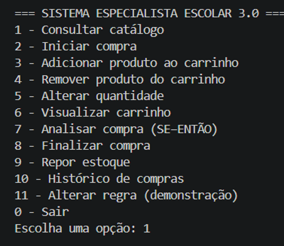
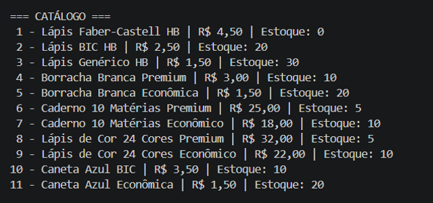
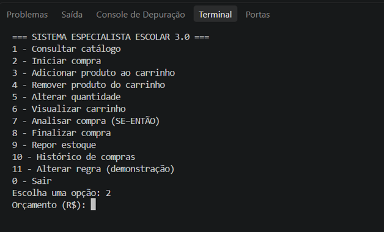
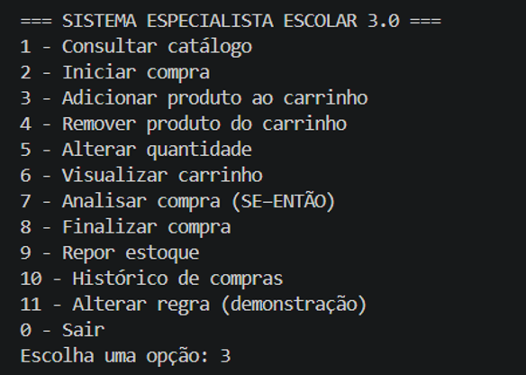
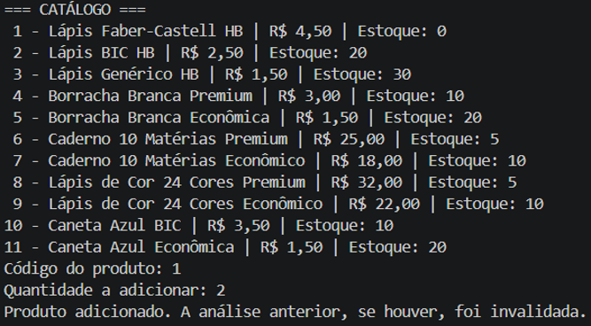
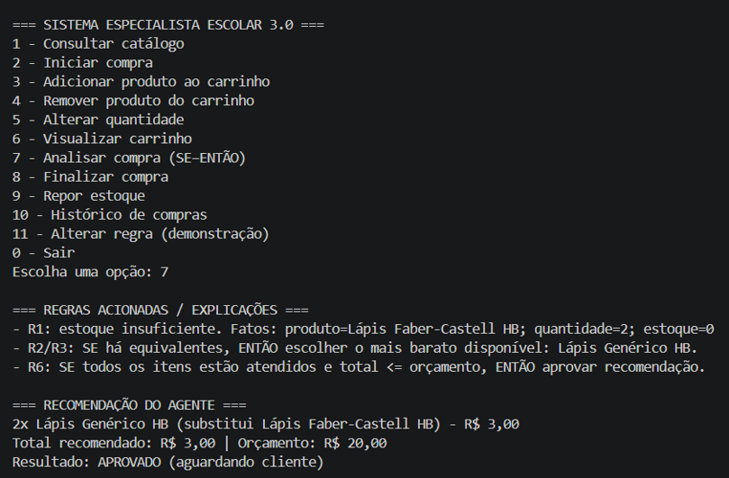
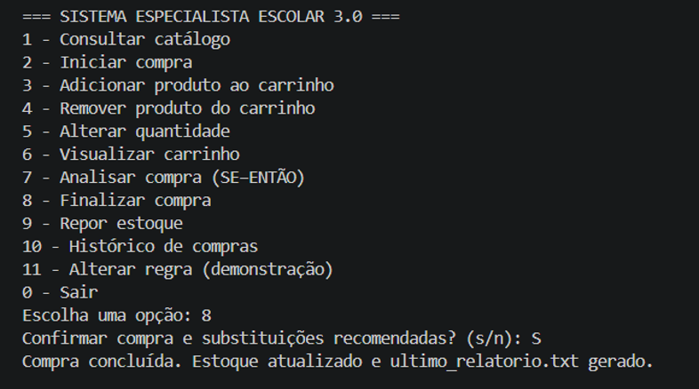
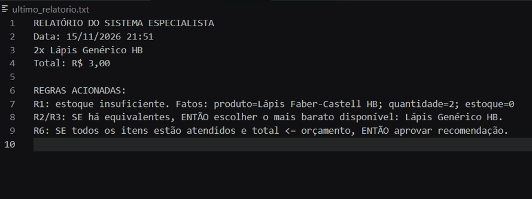

SISTEMA ESPECIALISTA PARA TOMADA DE DECISÃO NA COMPRA DE MATERIAL ESCOLAR 
Documentação técnica, funcional e roteiro de demonstração 
Sistema Especialista Escolar 3.0 
Documentação técnica e funcional  

## 1. Resumo do projeto 
Este trabalho apresenta um sistema especialista, desenvolvido em Python, para apoiar a tomada de decisão na compra de materiais escolares. O programa recebe um orçamento e um carrinho de produtos, consulta o estoque e aplica regras condicionais SE–ENTÃO para recomendar a manutenção ou substituição de itens por equivalentes disponíveis e, quando necessário, mais econômicos. A versão analisada é a 3.0, com interface de terminal, execução local no VS Code ou em ambiente Python compatível, como o Google Colab. 
O sistema também permite modificar o limite máximo por produto, repor estoque, acompanhar o estado da compra, registrar compras concluídas e gerar um relatório textual. Os valores e estoques do catálogo são demonstrativos; não há integração com loja ou banco de dados. 

## 2. Problema e justificativa 
Ao adquirir uma lista escolar, o consumidor pode encontrar produtos indisponíveis, preços acima do orçamento e restrições de quantidade. Uma decisão manual exige comparar alternativas e verificar simultaneamente custo, equivalência e disponibilidade. O sistema organiza esses critérios em regras explícitas, tornando a recomendação rastreável por meio de uma trilha de explicações.

## 3. Objetivos 
Desenvolver um agente especialista baseado em regras SE–ENTÃO que auxilie a escolha de materiais escolares considerando estoque, equivalência de produto, orçamento e limites de quantidade. 
Cadastrar uma compra com orçamento e itens solicitados. 
Consultar o catálogo e verificar estoque disponível. 
Indicar produtos equivalentes do mesmo tipo quando o solicitado não puder ser atendido. 
Buscar substituições mais baratas quando o valor recomendado ultrapassar o orçamento. 
Explicar quais regras foram acionadas e por que uma compra foi aprovada ou não. 
Permitir alterações de estoque e de parâmetros de negócio, exigindo nova análise. 
Confirmar compras aprovadas, atualizar estoque e registrar histórico e relatório. 

## 4. Escopo e requisitos 
Requisitos funcionais 

| ID | Requisito |
|:---:|---|
| RF01 | Consultar catálogo |
| RF02 | Iniciar compra com orçamento |
| RF03 | Adicionar itens ao carrinho |
| RF04 | Remover itens |
| RF05 | Alterar quantidade |
| RF06 | Visualizar carrinho |
| RF07 | Analisar compra por regras SE–ENTÃO |
| RF08 | Finalizar compra aprovada |
| RF09 | Repor estoque |
| RF10 | Consultar histórico da sessão |
| RF11 | Alterar limite máximo por produto |

Requisitos não funcionais 
Implementação em Python, utilizando somente bibliotecas padrão (datetime e copy). 
Interação por terminal, com menu numerado e entrada de dados pelo teclado. 
Explicabilidade: exibição de uma trilha textual das regras acionadas. 
Consistência: a análise simula a reserva de estoque sem alterar o estoque real. 
Persistência limitada: estoque, regras e histórico são mantidos em memória durante a execução; o último relatório de compra é salvo em arquivo TXT. 

## 5. Estrutura da solução 
O código organiza a aplicação em funções e estruturas de dados globais. Não há classes nem módulos separados nesta versão; a separação é lógica, por responsabilidade. 

| Componente | Representação no Código | Responsabilidade |
|---|---|---|
| Base de fatos | `PRODUTOS_INICIAIS / produtos` | Catálogo: nome, tipo, preço e estoque por código. |
| Memória de trabalho | `compra` | Orçamento, itens, análise e estado da compra atual. |
| Base de regras | `regras` e condições do motor | Limite por produto e critérios de seleção, substituição e aprovação. |
| Motor de inferência | `motor_inferencia(itens, orcamento)` | Avalia fatos, aplica regras e retorna recomendação, pendências, total e trilha. |
| Interface | `menu()` e funções auxiliares | Interação por terminal. |
| Histórico / saída | `historico` e `ultimo_relatorio.txt` | Registro em memória e relatório da última compra finalizada. |
 
 Fluxo geral de processamento 
Iniciar compra → adicionar/editar itens → analisar → (se necessário) ajustar carrinho, orçamento ou regras → analisar novamente → confirmar → atualizar estoque e registrar compra. A análise não desconta o estoque real; o desconto ocorre apenas na finalização confirmada. 

## 6. Regras de negócio e inferência 
O motor utiliza encadeamento para frente: parte dos fatos conhecidos (itens solicitados, preços, estoque, orçamento e limite) e executa condições para chegar à recomendação. A trilha de inferência registra os passos relevantes. 

| Regra | Condição SE | Ação ENTÃO |
|:---:|---|---|
| Limite | Quantidade solicitada > limite configurado | Marcar item como pendente e exigir ajuste. |
| R1 | Estoque do item solicitado ≥ quantidade | Manter produto solicitado. |
| R2/R3 | Estoque insuficiente e existe equivalente do mesmo tipo com estoque suficiente | Selecionar o equivalente de menor preço. |
| R4 | Não existe equivalente disponível em quantidade suficiente | Marcar item como pendente. |
| R5 | Total recomendado > orçamento | Tentar substituir itens por equivalentes mais baratos com estoque suficiente. |
| R6 | Todos os itens atendidos, carrinho não vazio e total ≤ orçamento | Aprovar recomendação; caso contrário, não aprovar. |
 
Equivalência é definida pelo campo “tipo”, e não por marca ou tamanho em campos separados. A escolha inicial de alternativa prioriza o menor preço disponível; a etapa R5 tenta reduções adicionais, mas não garante a combinação global de menor custo possível. A aprovação exige ausência de pendências e valor dentro do orçamento. 

Exemplo de raciocínio 
Fatos: pedido de 2 unidades do produto 1 (Lápis Faber-Castell HB), estoque 0, orçamento de R$ 20,00. R1 identifica indisponibilidade; R2/R3 buscam itens do tipo lapis_hb com estoque suficiente e selecionam o produto 3 (Lápis Genérico HB), por R$ 1,50 a unidade. Total recomendado: R$ 3,00. Sem pendências, R6 aprova a recomendação. 

## 7. Máquina de estados 

| Estado | Significado |
|---|---|
| CARRINHO_ABERTO | Compra iniciada ou modificada; requer análise. |
| EM_ANALISE | Processamento da inferência. |
| AGUARDANDO_CONFIRMACAO | Análise aprovada; cliente pode confirmar. |
| AJUSTE_NECESSARIO | Análise não aprovada; há restrição a resolver. |
| COMPRA_FINALIZADA | Estado atribuído imediatamente antes de limpar a compra corrente. |
 
Alterações de itens, estoque ou limite invalidam a análise anterior e retornam o estado para CARRINHO_ABERTO. Antes de finalizar, o motor recalcula a recomendação para evitar confirmar um resultado desatualizado. Após uma finalização bem-sucedida, a variável compra é redefinida para None. 
## 8. Funcionalidades do menu 

| Opção | Ação |
|:---:|---|
| 1 | Consultar catálogo |
| 2 | Iniciar compra |
| 3 | Adicionar produto ao carrinho |
| 4 | Remover produto do carrinho |
| 5 | Alterar quantidade |
| 6 | Visualizar carrinho |
| 7 | Analisar compra (SE–ENTÃO) |
| 8 | Finalizar compra |
| 9 | Repor estoque |
| 10 | Histórico de compras |
| 11 | Alterar regra (demonstração) |
| 0 | Sair |

## 9. Cenários de Teste e Resultados Esperados

Para verificar o funcionamento do Sistema Especialista Escolar 3.0, foram definidos quatro cenários de teste. Cada cenário apresenta uma situação diferente de compra, permitindo observar como o motor de inferência utiliza as regras SE–ENTÃO para tomar decisões.

Os resultados apresentados foram definidos com base nas regras e nos dados iniciais do código. Portanto, são **resultados esperados pela análise da implementação**, e não registros de testes executados e comprovados por capturas de tela.

### 9.1 Cenário 1 — Produto Indisponível

**Objetivo:** verificar como o sistema reage quando o produto solicitado não possui estoque suficiente.

**Procedimento:**

1. Iniciar uma compra com orçamento de R$ 20,00.
2. Adicionar 2 unidades do produto 1.
3. Selecionar a opção 7 do menu para analisar a compra.

**Resultado esperado:**

O sistema identifica que o produto solicitado está indisponível e procura uma alternativa equivalente.

A recomendação é substituir o produto solicitado por 2 unidades do produto 3 (Lápis Genérico HB).

- **Produto recomendado:** Lápis Genérico HB.
- **Quantidade:** 2 unidades.
- **Valor total:** R$ 3,00.
- **Situação:** compra aprovada.

### 9.2 Cenário 2 — Orçamento Insuficiente

**Objetivo:** verificar se o sistema consegue recomendar uma alternativa mais econômica quando o produto solicitado ultrapassa o orçamento disponível.

**Procedimento:**

1. Iniciar uma compra com orçamento de R$ 20,00.
2. Adicionar 1 unidade do produto 6 (Caderno 10 Matérias Premium).
3. Selecionar a opção 7 do menu para analisar a compra.

**Resultado esperado:**

O motor de inferência identifica que o valor do produto ultrapassa o orçamento disponível.

Nesse caso, a regra **R5** é aplicada para procurar um produto equivalente com preço menor.

O sistema recomenda a substituição pelo produto 7 (Caderno 10 Matérias Econômico).

- **Produto recomendado:** Caderno 10 Matérias Econômico.
- **Quantidade:** 1 unidade.
- **Valor total:** R$ 18,00.
- **Regra aplicada:** R5 — Substituição por alternativa mais econômica.
- **Situação:** compra aprovada.

### 9.3 Cenário 3 — Mudança de Regra

**Objetivo:** demonstrar como uma alteração nas regras de negócio pode modificar o resultado da análise.

**Procedimento:**

1. Iniciar uma compra com orçamento de R$ 30,00.
2. Adicionar 8 unidades do produto 2.
3. Executar a análise com o limite inicial de 10 unidades por produto.
4. Selecionar a opção 11 do menu para alterar o limite máximo para 5 unidades.
5. Executar novamente a análise da compra.

**Resultado esperado:**

Na primeira análise, o sistema aprova a compra porque a quantidade solicitada está dentro do limite permitido.

**Primeira análise:**

- **Quantidade solicitada:** 8 unidades.
- **Limite configurado:** 10 unidades.
- **Valor unitário:** R$ 2,50.
- **Valor total:** R$ 20,00.
- **Situação:** compra aprovada.

Após a alteração do limite para 5 unidades, o sistema realiza uma nova análise e identifica que a quantidade solicitada ultrapassa o limite permitido.

**Segunda análise:**

- **Quantidade solicitada:** 8 unidades.
- **Novo limite configurado:** 5 unidades.
- **Situação:** compra não aprovada.
- **Motivo:** quantidade superior ao limite permitido.

Esse cenário demonstra que o motor de inferência considera as alterações nas regras de negócio e pode apresentar decisões diferentes para uma mesma compra.

### 9.4 Cenário 4 — Produto Sem Alternativa Disponível

**Objetivo:** verificar o comportamento do sistema quando não existe estoque suficiente do produto solicitado nem de seus equivalentes.

**Procedimento:**

1. Configurar o limite máximo por produto para 11 unidades ou mais.
2. Iniciar uma compra com orçamento suficiente.
3. Solicitar 11 unidades do produto 6 (Caderno 10 Matérias Premium).
4. Selecionar a opção 7 para analisar a compra.

**Resultado esperado:**

O sistema verifica a disponibilidade do produto solicitado e identifica que existem apenas 5 unidades em estoque.

Em seguida, procura um produto equivalente e encontra o produto 7 (Caderno 10 Matérias Econômico), que possui 10 unidades disponíveis.

Como nenhum dos produtos possui individualmente as 11 unidades solicitadas, o sistema não consegue realizar a substituição.

- **Quantidade solicitada:** 11 unidades.
- **Estoque do produto 6:** 5 unidades.
- **Estoque do produto 7:** 10 unidades.
- **Situação:** compra não aprovada.
- **Motivo:** estoque insuficiente e ausência de alternativa com quantidade suficiente.

Esse cenário demonstra que o sistema não aprova uma compra quando não consegue atender à quantidade solicitada.

---

## 10. Como Executar o Sistema no VS Code

O Sistema Especialista Escolar 3.0 foi desenvolvido em Python e pode ser executado diretamente pelo terminal do Visual Studio Code.

### 10.1 Requisitos para Execução

Antes de executar o programa, é necessário ter:

- Python instalado no computador.
- Visual Studio Code instalado.
- Extensão Python instalada no VS Code.
- Arquivo `sistema_especialista_escolar_corrigido.py` salvo na pasta do projeto.

### 10.2 Passo a Passo para Executar

**Passo 1 — Abrir o VS Code**

Abra o Visual Studio Code no computador.

**Passo 2 — Abrir a pasta do projeto**

No menu superior, selecione:

`Arquivo → Abrir Pasta`

Em seguida, escolha a pasta onde está salvo o projeto.

**Passo 3 — Abrir o terminal**

No menu superior, selecione:

`Terminal → Novo Terminal`

O terminal será exibido na parte inferior da tela.

**Passo 4 — Executar o programa**

Digite o seguinte comando:

```bash
python sistema_especialista_escolar_corrigido.py
```

Em alguns computadores com Windows, também é possível executar utilizando:

```bash
py sistema_especialista_escolar_corrigido.py
```

**Passo 5 — Utilizar o sistema**

Após a execução, o programa apresenta um menu com as funcionalidades disponíveis.

O usuário deve digitar o número correspondente à operação desejada e seguir as instruções apresentadas na tela.

**Passo 6 — Consultar o relatório**

Após finalizar uma compra aprovada, o programa gera o arquivo:

`ultimo_relatorio.txt`

Esse arquivo contém as informações da última compra concluída e pode ser encontrado na pasta de execução do terminal.

### 10.3 Inicialização do Programa

Para que o programa seja executado corretamente, o código deve conter a seguinte estrutura de inicialização:

```python
if __name__ == "__main__":
    menu()
```

Essa estrutura permite que a função `menu()` seja executada quando o arquivo Python é iniciado diretamente.

A versão corrigida do sistema utiliza essa estrutura.

---

## 11. Estruturas de Dados e Saídas

O Sistema Especialista Escolar 3.0 utiliza estruturas de dados do Python para armazenar as informações dos produtos, controlar as compras e registrar as decisões realizadas pelo motor de inferência.

### 11.1 Catálogo de Produtos

O catálogo é organizado em um dicionário, no qual cada produto é identificado por um código.

Cada registro contém as seguintes informações:

- **Nome:** identificação do produto.
- **Tipo:** categoria utilizada para procurar equivalentes.
- **Preço:** valor unitário do produto.
- **Estoque:** quantidade disponível para compra.

### 11.2 Carrinho de Compras

O carrinho utiliza um dicionário que relaciona o código de cada produto à quantidade solicitada.

Essa estrutura permite adicionar, remover e alterar as quantidades dos produtos durante a compra.

### 11.3 Resultado da Análise

Após aplicar as regras SE–ENTÃO, o motor de inferência retorna informações utilizadas para apresentar o resultado da compra.

Entre elas estão:

- Carrinho recomendado.
- Produtos pendentes.
- Valor total da recomendação.
- Situação de aprovação da compra.
- Trilha das regras utilizadas na decisão.

### 11.4 Histórico de Compras

O histórico é armazenado em uma lista de registros, contendo informações como:

- Data da compra.
- Valor total.
- Produtos selecionados.
- Regras acionadas durante a análise.

Esse histórico permanece disponível enquanto o programa está em execução.

### 11.5 Relatório da Última Compra

Ao finalizar uma compra, o sistema gera o arquivo:

`ultimo_relatorio.txt`

O relatório apresenta a data, os produtos efetivamente selecionados, o valor total e a trilha das regras utilizadas.

**Observação:** como o arquivo possui um nome fixo, uma nova compra finalizada substitui o relatório anterior.

Além disso, o histórico armazenado em memória é perdido quando o programa é encerrado.

---

## 12. Limitações e Possibilidades de Evolução

Apesar de atender aos objetivos propostos, o Sistema Especialista Escolar 3.0 apresenta algumas limitações por se tratar de um protótipo acadêmico.

### 12.1 Limitações Atuais

**1. Catálogo limitado**

O sistema possui 11 produtos demonstrativos cadastrados inicialmente e não permite adicionar novos produtos diretamente pelo menu.

**2. Informações dos produtos**

Características como marca e tamanho aparecem apenas no nome de alguns produtos.

O sistema ainda não possui campos específicos para utilizar essas características na identificação de produtos equivalentes.

**3. Substituição de produtos**

O algoritmo não divide automaticamente a quantidade solicitada entre dois ou mais produtos equivalentes.

Por exemplo, se o usuário solicitar 11 cadernos e houver 5 unidades de um modelo e 10 de outro, o sistema não combina os estoques para atender ao pedido.

**4. Busca por economia**

A busca por alternativas mais baratas utiliza uma estratégia heurística.

Por esse motivo, o sistema pode encontrar uma solução adequada sem necessariamente identificar a combinação de menor custo possível.

**5. Armazenamento de dados**

O sistema ainda não possui banco de dados, autenticação de usuários ou interface web.

Também não mantém as alterações de estoque entre diferentes execuções.

**6. Testes automatizados**

Algumas funções realizam verificações de entradas inválidas, mas o projeto ainda não possui uma suíte automatizada de testes.

### 12.2 Possibilidades de Evolução

Como melhorias futuras, o projeto poderá receber:

- **Organização em módulos:** separar catálogo, regras de negócio, motor de inferência e interface.
- **Cadastro de produtos:** permitir adicionar, editar e excluir materiais escolares.
- **Informações detalhadas:** incluir campos específicos para marca, tamanho e unidade.
- **Testes automatizados:** verificar o funcionamento das regras e das operações do sistema.
- **Banco de dados SQLite:** armazenar produtos, estoque e histórico de compras.
- **Interface web:** permitir que o sistema seja utilizado pelo navegador.
- **Melhoria nas recomendações:** aperfeiçoar a busca por alternativas e combinações de produtos.

Essas melhorias poderão tornar o sistema mais completo e facilitar sua utilização em situações reais.

---

## 13. Conclusão

O desenvolvimento do Sistema Especialista Escolar 3.0 permitiu colocar em prática os conceitos de sistemas especialistas e regras de decisão SE–ENTÃO.

O projeto foi criado para ajudar na compra de materiais escolares, considerando informações como preço, quantidade disponível em estoque e orçamento do usuário.

Durante o funcionamento, o motor de inferência analisa essas informações e aplica as regras definidas para decidir se a compra pode ser aprovada ou se é necessário recomendar outro produto.

Outro ponto importante é o controle dos estados da compra, que permite acompanhar as etapas do processo e realizar uma nova verificação antes da finalização, evitando decisões baseadas em informações desatualizadas.

Mesmo sendo um projeto acadêmico e apresentando algumas limitações, o sistema demonstra como a programação em Python pode ser utilizada para desenvolver soluções que auxiliam na tomada de decisão.

Com esse trabalho, foi possível compreender melhor o funcionamento de uma base de fatos, de uma base de regras e de um motor de inferência, além de perceber como esses componentes podem trabalhar juntos para resolver problemas do dia a dia.

Portanto, o Sistema Especialista Escolar 3.0 atende ao objetivo de demonstrar, de maneira prática, a aplicação de conhecimentos de Inteligência Artificial na construção de um sistema de apoio à decisão. 

 Evidências a anexar antes da entrega 

1️⃣ Consultar o catálogo 
Digite: 1 


 
Catalogo 



2️⃣ Iniciar uma compra 
Digite: 2 


 
3️⃣ Adicionar um produto 
Digite: 3 




 
4️⃣ Executar a análise SE–ENTÃO 
Digite: 7 


 
Finalizar a compra 
Digite: 8 


 
relatório TXT gerado 

 
Fonte do projeto: arquivo Python “sistema_especialista_escolar_corrigido.py”, disponibilizado pelo(a) aluno(a). Documentação elaborada com base no código-fonte da versão 3.0. 
 
Sistema Especialista Escolar 3.0  •  Documentação técnica e funcional 
 
