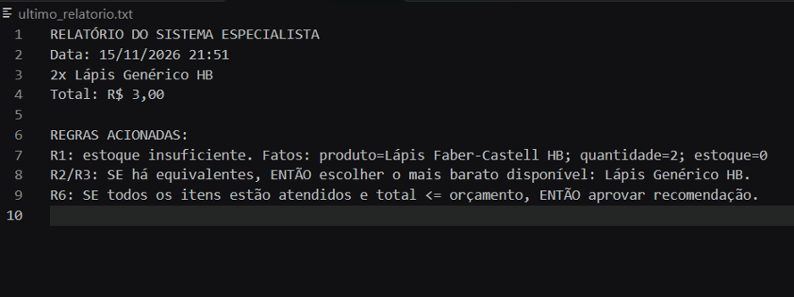

SISTEMA ESPECIALISTA PARA TOMADA DE DECISÃO NA COMPRA DE MATERIAL ESCOLAR 
Documentação técnica, funcional e roteiro de demonstração 
Sistema Especialista Escolar 3.0  •  Documentação técnica e funcional  
1. Resumo do projeto 
Este trabalho apresenta um sistema especialista, desenvolvido em Python, para apoiar a tomada de decisão na compra de materiais escolares. O programa recebe um orçamento e um carrinho de produtos, consulta o estoque e aplica regras condicionais SE–ENTÃO para recomendar a manutenção ou substituição de itens por equivalentes disponíveis e, quando necessário, mais econômicos. A versão analisada é a 3.0, com interface de terminal, execução local no VS Code ou em ambiente Python compatível, como o Google Colab. 
O sistema também permite modificar o limite máximo por produto, repor estoque, acompanhar o estado da compra, registrar compras concluídas e gerar um relatório textual. Os valores e estoques do catálogo são demonstrativos; não há integração com loja ou banco de dados. 
2. Problema e justificativa 
Ao adquirir uma lista escolar, o consumidor pode encontrar produtos indisponíveis, preços acima do orçamento e restrições de quantidade. Uma decisão manual exige comparar alternativas e verificar simultaneamente custo, equivalência e disponibilidade. O sistema organiza esses critérios em regras explícitas, tornando a recomendação rastreável por meio de uma trilha de explicações. 
3. Objetivos 
Desenvolver um agente especialista baseado em regras SE–ENTÃO que auxilie a escolha de materiais escolares considerando estoque, equivalência de produto, orçamento e limites de quantidade. 
Cadastrar uma compra com orçamento e itens solicitados. 
Consultar o catálogo e verificar estoque disponível. 
Indicar produtos equivalentes do mesmo tipo quando o solicitado não puder ser atendido. 
Buscar substituições mais baratas quando o valor recomendado ultrapassar o orçamento. 
Explicar quais regras foram acionadas e por que uma compra foi aprovada ou não. 
Permitir alterações de estoque e de parâmetros de negócio, exigindo nova análise. 
Confirmar compras aprovadas, atualizar estoque e registrar histórico e relatório. 
4. Escopo e requisitos 
Requisitos funcionais 
| ID | Requisito |
|:---:|---|
| RF01 | Consultar catálogo |
| RF02 | Iniciar compra com orçamento |
| RF03 | Adicionar itens ao carrinho |
| RF04 | Remover itens |
| RF05 | Alterar quantidade |
| RF06 | Visualizar carrinho |
| RF07 | Analisar compra por regras SE–ENTÃO |
| RF08 | Finalizar compra aprovada |
| RF09 | Repor estoque |
| RF10 | Consultar histórico da sessão |
| RF11 | Alterar limite máximo por produto |
4.2 Requisitos não funcionais 
Implementação em Python, utilizando somente bibliotecas padrão (datetime e copy). 
Interação por terminal, com menu numerado e entrada de dados pelo teclado. 
Explicabilidade: exibição de uma trilha textual das regras acionadas. 
Consistência: a análise simula a reserva de estoque sem alterar o estoque real. 
Persistência limitada: estoque, regras e histórico são mantidos em memória durante a execução; o último relatório de compra é salvo em arquivo TXT. 
5. Estrutura da solução 
O código organiza a aplicação em funções e estruturas de dados globais. Não há classes nem módulos separados nesta versão; a separação é lógica, por responsabilidade. 
| Componente | Representação no Código | Responsabilidade |
|---|---|---|
| Base de fatos | `PRODUTOS_INICIAIS / produtos` | Catálogo: nome, tipo, preço e estoque por código. |
| Memória de trabalho | `compra` | Orçamento, itens, análise e estado da compra atual. |
| Base de regras | `regras` e condições do motor | Limite por produto e critérios de seleção, substituição e aprovação. |
| Motor de inferência | `motor_inferencia(itens, orcamento)` | Avalia fatos, aplica regras e retorna recomendação, pendências, total e trilha. |
| Interface | `menu()` e funções auxiliares | Interação por terminal. |
| Histórico / saída | `historico` e `ultimo_relatorio.txt` | Registro em memória e relatório da última compra finalizada. |
 
5.1 Fluxo geral de processamento 
Iniciar compra → adicionar/editar itens → analisar → (se necessário) ajustar carrinho, orçamento ou regras → analisar novamente → confirmar → atualizar estoque e registrar compra. A análise não desconta o estoque real; o desconto ocorre apenas na finalização confirmada. 
6. Regras de negócio e inferência 
O motor utiliza encadeamento para frente: parte dos fatos conhecidos (itens solicitados, preços, estoque, orçamento e limite) e executa condições para chegar à recomendação. A trilha de inferência registra os passos relevantes. 

| Regra | Condição SE | Ação ENTÃO |
|:---:|---|---|
| Limite | Quantidade solicitada > limite configurado | Marcar item como pendente e exigir ajuste. |
| R1 | Estoque do item solicitado ≥ quantidade | Manter produto solicitado. |
| R2/R3 | Estoque insuficiente e existe equivalente do mesmo tipo com estoque suficiente | Selecionar o equivalente de menor preço. |
| R4 | Não existe equivalente disponível em quantidade suficiente | Marcar item como pendente. |
| R5 | Total recomendado > orçamento | Tentar substituir itens por equivalentes mais baratos com estoque suficiente. |
| R6 | Todos os itens atendidos, carrinho não vazio e total ≤ orçamento | Aprovar recomendação; caso contrário, não aprovar. |
 
Equivalência é definida pelo campo “tipo”, e não por marca ou tamanho em campos separados. A escolha inicial de alternativa prioriza o menor preço disponível; a etapa R5 tenta reduções adicionais, mas não garante a combinação global de menor custo possível. A aprovação exige ausência de pendências e valor dentro do orçamento. 
6.1 Exemplo de raciocínio 
Fatos: pedido de 2 unidades do produto 1 (Lápis Faber-Castell HB), estoque 0, orçamento de R$ 20,00. R1 identifica indisponibilidade; R2/R3 buscam itens do tipo lapis_hb com estoque suficiente e selecionam o produto 3 (Lápis Genérico HB), por R$ 1,50 a unidade. Total recomendado: R$ 3,00. Sem pendências, R6 aprova a recomendação. 

7. Máquina de estados 
| Estado | Significado |
|---|---|
| CARRINHO_ABERTO | Compra iniciada ou modificada; requer análise. |
| EM_ANALISE | Processamento da inferência. |
| AGUARDANDO_CONFIRMACAO | Análise aprovada; cliente pode confirmar. |
| AJUSTE_NECESSARIO | Análise não aprovada; há restrição a resolver. |
| COMPRA_FINALIZADA | Estado atribuído imediatamente antes de limpar a compra corrente. |
 
Alterações de itens, estoque ou limite invalidam a análise anterior e retornam o estado para CARRINHO_ABERTO. Antes de finalizar, o motor recalcula a recomendação para evitar confirmar um resultado desatualizado. Após uma finalização bem-sucedida, a variável compra é redefinida para None. 
8. Funcionalidades do menu 
| Opção | Ação |
|:---:|---|
| 1 | Consultar catálogo |
| 2 | Iniciar compra |
| 3 | Adicionar produto ao carrinho |
| 4 | Remover produto do carrinho |
| 5 | Alterar quantidade |
| 6 | Visualizar carrinho |
| 7 | Analisar compra (SE–ENTÃO) |
| 8 | Finalizar compra |
| 9 | Repor estoque |
| 10 | Histórico de compras |
| 11 | Alterar regra (demonstração) |
| 0 | Sair |
 
9. Cenários de teste e resultados esperados 
Os cenários abaixo foram definidos a partir das regras e dos dados iniciais do código. São resultados esperados por inspeção da implementação; não representam evidência de execução capturada em tela. 
Cenário 1 — Produto indisponível 
Procedimento: iniciar compra com orçamento de R$ 20,00; adicionar 2 unidades do produto 1; executar opção 7. Resultado esperado: substituição por 2 unidades do produto 3 (Lápis Genérico HB), total R$ 3,00 e recomendação aprovada. 
Cenário 2 — Orçamento insuficiente 
Procedimento: iniciar compra com orçamento de R$ 20,00; adicionar 1 unidade do produto 6 (Caderno 10 Matérias Premium); executar opção 7. Resultado esperado: R5 troca pelo produto 7 (Caderno 10 Matérias Econômico), total R$ 18,00, recomendação aprovada. 
Cenário 3 — Mudança de regra 
Procedimento: iniciar compra com orçamento suficiente (por exemplo R$ 30,00); adicionar 8 unidades do produto 2; analisar com limite inicial de 10; em seguida, usar opção 11 para reduzir o limite a 5 e analisar novamente. Resultado esperado: primeira análise aprovada (8 × R$ 2,50 = R$ 20,00); segunda análise não aprovada, com pendência por limite excedido. 
Cenário 4 — Sem alternativa 
Procedimento: solicitar 11 unidades do produto 6, mantendo limite configurado em 11 ou mais. Como há 5 unidades do produto 6 e 10 do produto 7, nenhum dos dois atende sozinho às 11 unidades. Resultado esperado: item pendente por falta de equivalente em estoque; compra não aprovada. 
10. Como executar no VS Code 
Instalar Python no computador e a extensão Python no Visual Studio Code. 
Criar uma pasta para o projeto e salvar nela o arquivo sistema_especialista_escolar_corrigido.py. 
No VS Code, selecionar Arquivo → Abrir Pasta e abrir a pasta do projeto. 
Abrir Terminal → Novo Terminal e executar: python sistema_especialista_escolar_corrigido.py (no Windows, também pode funcionar: py sistema_especialista_escolar_corrigido.py). 
Escolher as opções do menu pelo número e seguir as instruções exibidas. 
Após finalizar uma compra, localizar o arquivo ultimo_relatorio.txt na pasta de execução do terminal. 
O trecho de inicialização deve ser escrito exatamente como: if __name__ == "__main__": seguido de menu() indentado. A versão enviada contém essa forma correta. 
11. Estruturas de dados e saídas 
O catálogo é um dicionário indexado por código de produto. Cada registro contém nome, tipo, preco e estoque. O carrinho é um dicionário de código para quantidade. A análise devolve carrinho recomendado, pendentes, total, aprovado e trilha. O histórico é uma lista de registros com data, total, itens e regras acionadas. 
Ao concluir uma compra, o programa grava ultimo_relatorio.txt com data, produtos efetivamente selecionados, total e trilha de regras. Como o nome do arquivo é fixo, a próxima compra concluída sobrescreve o relatório anterior. O histórico em memória é perdido quando o processo termina. 
12. Limitações e possibilidades de evolução 
O catálogo possui 11 produtos demonstrativos e não permite cadastrar novos produtos pelo menu. 
Marca e tamanho aparecem apenas no nome de alguns produtos; não existem campos próprios para filtrar equivalência por essas características. 
O algoritmo não divide automaticamente a quantidade de um item entre dois produtos equivalentes. 
A busca de economia é heurística e pode não encontrar a combinação de menor custo global. 
Não há banco de dados, autenticação, interface web nem persistência de estoque entre execuções. 
Entradas inválidas são tratadas em funções específicas, mas não há suíte automatizada de testes no arquivo. 
Como evolução, recomenda-se separar catálogo, regras, inferência e interface em módulos; adicionar cadastro e atributos estruturados (marca, tamanho, unidade); implementar testes automatizados; persistir dados em SQLite; e criar interface web sem alterar a lógica de decisão. 
git push origin main13. Conclusão 
O Sistema Especialista Escolar 3.0 demonstra a aplicação prática de regras SE–ENTÃO em uma situação cotidiana de compra. O motor de inferência combina fatos de estoque, orçamento e quantidade para produzir recomendações explicáveis, enquanto o controle de estados e a revalidação antes da finalização reduzem o risco de confirmar decisões desatualizadas. O projeto atende ao objetivo didático de demonstrar tomada de decisão baseada em conhecimento explícito, com limitações compatíveis com um protótipo acadêmico. 
 Evidências a anexar antes da entrega 

1️⃣ Consultar o catálogo 
Digite: 1 

 
Catalogo 

2️⃣ Iniciar uma compra 
Digite: 2 

 
3️⃣ Adicionar um produto 
Digite: 3 

 
4️⃣ Executar a análise SE–ENTÃO 
Digite: 7 
 
Finalizar a compra 
Digite: 8 

 
relatório TXT gerado 

 
Fonte do projeto: arquivo Python “sistema_especialista_escolar_corrigido.py”, disponibilizado pelo(a) aluno(a). Documentação elaborada com base no código-fonte da versão 3.0. 
 
Sistema Especialista Escolar 3.0  •  Documentação técnica e funcional 
 
